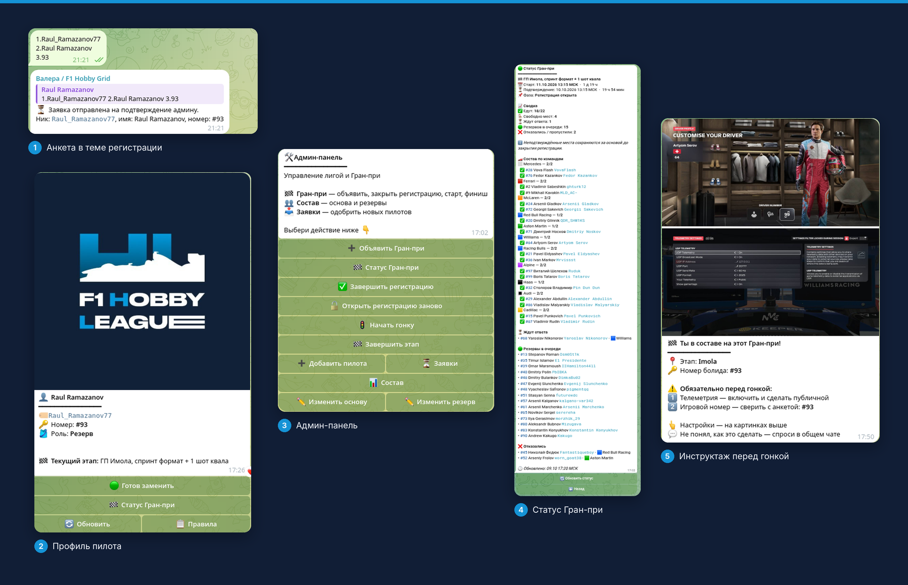

[](https://t.me/+-kAatqK0oxVhZjc6) [](https://t.me/HobbyLeagueBot)

# 🏎️ F1 Hobby League Bot

**Telegram-бот, который ведёт любительскую лигу F1: регистрация пилотов прямо в боте, подтверждение участия, автоматическое закрытие регистрации и жеребьёвка резервов, замены перед стартом, штрафы, проверка лобби и статус Гран-при в реальном времени.**


### 👉 [Попробовать бота — @HobbyLeagueBot](https://t.me/HobbyLeagueBot) · 🏁 [Группа лиги F1 Hobby League](https://t.me/+-kAatqK0oxVhZjc6)

> 🟢 **Бот рабочий и используется прямо сейчас.** Это не учебный пример и не демо: [@HobbyLeagueBot](https://t.me/HobbyLeagueBot) в продакшене обслуживает лигу **[F1 Hobby League](https://t.me/+-kAatqK0oxVhZjc6)** — через него проходят регистрация пилотов, подтверждения на каждый этап, распределение мест в сетке и замены перед стартом.

---

## 📖 О проекте

Любительская лига в F1 — это 22 места на стартовой решётке, 11 команд, основной состав, длинная очередь резервов и чат, в котором перед каждым этапом начинается хаос: «я еду», «а я не успеваю», «можно я вместо него?», «а у меня какой номер?», «он вылетел из лобби!». Админ вручную собирает ответы, считает свободные кресла, решает, кто из резервов поедет, и за полчаса до старта ищет замену тому, кто не отвечает.

**F1 Hobby League Bot** забирает всю эту рутину на себя. Пилот регистрируется прямо в личке с ботом — по шагам, с выбором свободного номера кнопкой. Перед каждым Гран-при основной состав подтверждает участие, резервы жмут «Готов заменить». В выбранное админом время бот **сам закрывает регистрацию** и честной случайной жеребьёвкой раздаёт пустые места готовым резервам. Отказался кто-то уже после закрытия — его место тут же получает резерв из листа ожидания. Перед стартом пилоты отмечаются «Я в лобби ✅», а админ одной кнопкой снимает с этапа того, кто пропал, и отдаёт место конкретному резерву или разыгрывает его.

Бот делался под конкретную лигу — **[F1 Hobby League](https://t.me/+-kAatqK0oxVhZjc6)** — и вырос из её реальных проблем. Отсюда детали, которые появляются только после живых гонок: номера болидов, разрешённые в игре; напоминание включить публичную телеметрию со скриншотами; защита от двойных нажатий и одновременных действий нескольких админов; чат, который не засоряется служебными сообщениями.

Проект будет полезен организаторам онлайн-лиг по F1 (и не только), а также тем, кто хочет посмотреть на живой пример бота на **aiogram 3** с FSM-мастерами, инлайн-календарём, транзакциями SQLite, фоновыми задачами и работой с темами (topics) в Telegram-группах.

---

## ✨ Возможности

### 🏁 Управление Гран-при
- Пошаговый мастер создания этапа: название → дата во **встроенном инлайн-календаре** → час → минуты → **когда закрыть регистрацию** → проверка и публикация.
- Быстрое создание одной командой: `/open Гран-при Бахрейна | 21.10.2026 20:00 | 24`.
- **Автоматическое закрытие регистрации**: к старту, за 1, 2, 6, 12 часов или за сутки. В это время бот сам проводит жеребьёвку. Закрыть раньше вручную — по-прежнему одной кнопкой.
- Объявление уходит в тему мероприятий группы и **личным сообщением каждому пилоту** — с отчётом админу, скольким дошло.
- Полный жизненный цикл: открыть регистрацию → завершить → при необходимости открыть заново → «🚦 Начать гонку» → «🏁 Завершить этап».
- После завершения этапа бот **убирает служебные сообщения** («готов заменить», «вылетел из лобби», замены) и обновляет главный экран у всех пилотов.

### 👥 Роли
- **Администратор** — список ID задаётся в `.env`; админ-панель и управляющие команды.
- **Основной пилот** — закреплён за одной из 11 команд сезона 2026 (максимум 2 пилота на команду), подтверждает участие кнопками «✅ Подтверждаю» / «❌ Не еду». Промахнулся кнопкой — «✅ Всё-таки еду», пока регистрация открыта.
- **Резерв** — жмёт «🟢 Готов заменить» и участвует в жеребьёвке свободных мест.

### 📝 Регистрация прямо в боте
- Кнопка «📝 Регистрация» в личке: **ник → имя → номер болида** → проверка анкеты → «Отправить заявку».
- Номер выбирается **кнопками из свободных** (или вводится числом). Занят или закреплён за реальным пилотом F1 — бот покажет, какие номера свободны. Номера закончились — подскажет написать админам.
- Можно прислать анкету и одним сообщением в три строки — парсер прощает формат: `1.`, `1)`, `1:`, `#` или `№` перед номером.
- Проверки на лету: уникальность ника и номера, повторная заявка, заявка на рассмотрении.
- Заявка прилетает **всем админам в личку** с кнопками «🔄 Резерв» / «🏎 Основа» (с выбором команды) / «❌ Отклонить».
- Анкету, написанную по старинке в теме регистрации группы, бот не теряет — отвечает кнопкой, которая сразу открывает мастер в личке.

### 🔄 Жеребьёвка и замены
- При закрытии регистрации основные пилоты без ответа получают статус «не подтвердил».
- Бот собирает все свободные кресла: места отказавшихся и не ответивших плюс пустые места в командах.
- Места и готовые резервы перемешиваются — **честная случайная жеребьёвка**. Кому не хватило места — попадают в **лист ожидания**.
- **Отказ после закрытия регистрации** (до старта): пилот жмёт «❌ Отказаться от участия» — его место сразу получает случайный резерв из листа ожидания. Резерв, вставший в ожидание позже, сразу получает свободное место, если оно есть.
- **Снять с этапа** (админ): выбрать участника и отдать его место конкретному резерву, разыграть заново или оставить свободным. Работает и после старта — когда в лобби выясняется, что кто-то пропал.
- Каждый получает личное сообщение: «Ты едешь, заменяешь такого-то», «Ты в листе ожидания» и т. д.
- Все операции идут в транзакциях `BEGIN IMMEDIATE` — двойное закрытие или ответ пилота в последнюю секунду ничего не сломают.

### ⚠️ Штрафы
- Админ выбирает пилота и начисляет штрафные баллы (быстрые кнопки +1/+2/+3/+5/+10 или своё число; отрицательное — снять).
- Причина штрафа и решение «пропускает ли следующую гонку».
- **Пропуск гонки** ставится и снимается вручную: если пилот уже в составе — место сразу уходит резерву; если этапа ещё нет — пропуск применится к следующему Гран-при.
- Таблица штрафов по всем пилотам; пилот получает уведомление и видит баллы в профиле.

### 🎮 Проверка лобби
- Участник сам отмечает «🎮 Я в лобби ✅» или «❌ Я вылетел».
- Админ рассылает всем участникам сообщение с кнопкой «Я в лобби ✅» и видит **живой список**: кто ещё не в лобби, кто уже на месте — обновляется кнопкой в том же сообщении.
- Напоминание только тем, кто не отметился; уведомление админам, когда кто-то вылетел и когда в лобби все.

### 📊 Статус Гран-при в реальном времени
- Фаза этапа, обратный отсчёт до старта и до закрытия регистрации.
- Сводка: сколько едут из 22, свободные места, кто ждёт ответа, лист ожидания, пропуски по штрафу.
- Состав по всем 11 командам с пометками «вместо такого-то» и «свободное место».
- Показывается только **активный** этап; между этапами — «Активного Гран-при сейчас нет».

### 📅 Расписание и турнирная таблица
- Админ загружает фото расписания, **личного** и **командного** зачёта.
- У пилотов — кнопки «📅 Расписание» и «🏆 Турнирная таблица» (зачёты переключаются в том же сообщении).
- Фото хранятся на сервере в `media/`; при обновлении старый файл удаляется.

### 📷 Инструктаж пилотов перед гонкой
- Всем, кто попал в состав (в том числе по замене), бот отправляет два скриншота: как включить **публичную UDP-телеметрию** и где сверить **номер болида**.
- Под инструкцией — кнопка **«✅ Ознакомился»**; нажатие уходит админам.

### 🧹 Чистый чат
- **Одно сообщение-экран в личке**: кнопки меняют текущее сообщение, а не присылают новые; команды и ответы пользователя удаляются после обработки.
- Пользовательские команды (`/start`, `/help`, `/status` …) в группе удаляются, вместо них на 15 секунд появляется кнопка «Открыть бота».
- Подтверждения участия идут админам в личку, а не в общий чат.

### 👤 Главный экран и профиль
- `/start` — текущий этап, время старта, фаза и крупно: **«✅ Ты едешь» / «❌ Ты не едешь» / «⏳ Подтверди участие»**, команда и отметка лобби.
- «👤 Мой профиль» — ник, имя, номер, роль, команда, штрафные баллы.

### 🛠️ Инструменты администратора
- Админ-панель `/admin` со всеми действиями на кнопках.
- Ручное добавление пилота — в основу (с выбором команды) или в резерв.
- Редактор состава: основа и резерв с пагинацией, перевод основа ↔ резерв, смена команды и номера, удаление.
- Очередь заявок (`/pending`), восстановление 11 команд (`/seed_teams`).

---

## 📸 Скриншоты



*Живые скриншоты из лиги F1 Hobby League.*

---

## ⚙️ Как это работает

Цикл одного Гран-при:

```text
 🛠 Админ создаёт этап (/admin → «Объявить Гран-при» или /open)
        │   выбирает, когда закрыть регистрацию
        │   объявление → тема лиги + личка каждому пилоту
        ▼
 🟢 Регистрация открыта
        ├── 🏎 Основа:  «✅ Подтверждаю» / «❌ Не еду» (передумал — «Всё-таки еду»)
        └── 🔄 Резерв:  «🟢 Готов заменить» / «⚪ Снять готовность»
        │
        ▼
 🔒 Регистрация закрывается — сама по времени или кнопкой админа
        ├── не ответившие основные → «не подтвердил»
        ├── свободные кресла = отказы + неответившие + пустые места
        ├── 🎲 случайная жеребьёвка: свободные кресла ↔ готовые резервы
        └── не хватило мест → 💤 лист ожидания
        │   личные уведомления + сводка в группу
        │   📷 попавшим в состав — инструктаж и «Ознакомился»
        ▼
 🔁 До старта: отказ участника → место сразу получает резерв из ожидания
        ▼
 🚦 Админ объявляет старт → 🎮 проверка лобби
        │   не отвечает? → «Снять с этапа» → конкретный резерв / розыгрыш
        ▼
 🏁 Админ завершает этап → служебные сообщения убираются → можно объявлять следующий
```

> 💡 Если что-то пошло не так после закрытия — «🔓 Открыть регистрацию заново» вернёт резервов в очередь и отменит назначения. Автозакрытие для такого этапа выключается — закрыть повторно нужно вручную.

---

## 🧰 Технологии

| Технология | Зачем |
|---|---|
| **Python 3.10+** | язык проекта |
| **[aiogram 3.15](https://docs.aiogram.dev/)** | асинхронный фреймворк для Telegram Bot API: роутеры, FSM, middleware, инлайн-клавиатуры |
| **SQLite + [aiosqlite](https://github.com/omnilib/aiosqlite)** | лёгкое встраиваемое хранилище; транзакции `BEGIN IMMEDIATE` защищают от гонок |
| **[python-dotenv](https://github.com/theskumar/python-dotenv)** | конфигурация через `.env` |

Под капотом также:
- `SimpleEventIsolation` — действия одного пользователя обрабатываются последовательно, двойной клик не создаст двух этапов;
- фоновая задача раз в минуту — автоматическое закрытие регистрации по времени;
- middleware, удаляющий сообщения пользователя в личке, и учёт «текущего экрана» — чат с ботом всегда из одного сообщения;
- автоматические миграции схемы при запуске — старая `bot.db` обновляется без ручных правок;
- обработка лимитов Telegram (`RetryAfter`) при массовых рассылках;
- глобальный обработчик ошибок: пользователь получает понятное сообщение, а подробности пишутся в лог.

---

## 🚀 Установка и запуск

### 1. Клонирование

```bash
git clone https://github.com/RaulRamazanov/f1-hobby-league-bot.git
cd f1-hobby-league-bot
```

### 2. Виртуальное окружение

```bash
python3 -m venv .venv
source .venv/bin/activate        # Windows: .venv\Scripts\activate
```

### 3. Установка зависимостей

```bash
pip install -r requirements.txt
```

### 4. Настройка `.env`

```bash
cp .env.example .env
```

```env
BOT_TOKEN=123456789:your-bot-token-from-BotFather
ADMIN_IDS=111111111,222222222
GROUP_ID=-1001234567890
REGISTRATION_THREAD_ID=2
EVENTS_THREAD_ID=0
```

| Переменная | Обязательна | Описание |
|---|:---:|---|
| `BOT_TOKEN` | ✅ | токен бота от [@BotFather](https://t.me/BotFather); без него бот не запустится |
| `ADMIN_IDS` | ✅ | Telegram ID администраторов через запятую |
| `GROUP_ID` | ✅ | ID группы лиги (начинается с `-100…`) |
| `REGISTRATION_THREAD_ID` | ➖ | ID темы регистрации в группе (туда бот ответит кнопкой, если анкету напишут в чат); `0` — любая тема |
| `EVENTS_THREAD_ID` | ➖ | отдельная тема для объявлений этапа; если `0` — используется тема, в которой создан этап |

> ℹ️ Свой Telegram ID удобно узнать командой `/whoami` в личке с ботом.
> Каждый админ должен хотя бы раз нажать `/start` у бота в личке, иначе бот не сможет присылать ему заявки.
> Бота нужно добавить в группу админом с правами **писать** и **удалять сообщения** (чтобы убирать пользовательские команды и служебные сообщения).

### 5. Картинки (по желанию)

В `app/assets/` лежат `f1.jpg` (обложка бота) и `tutor1.jpg`, `tutor2.jpg` (инструктаж по телеметрии). Чтобы поставить свою обложку, положите рядом `balera.png` — бот возьмёт её автоматически.

### 6. Первый запуск

```bash
python -m app.main
```

При старте бот сам создаёт `bot.db`, применяет миграции, заполняет 11 команд сезона 2026 и настраивает меню команд (пользовательские — только в личке).

### 7. Запуск как systemd-сервис

Создайте файл `/etc/systemd/system/f1bot.service` (пути и пользователя замените на свои):

```ini
[Unit]
Description=F1 Hobby League Telegram Bot
After=network-online.target
Wants=network-online.target

[Service]
Type=simple
User=f1bot
WorkingDirectory=/opt/f1-hobby-league-bot
ExecStart=/opt/f1-hobby-league-bot/.venv/bin/python -m app.main
Restart=always
RestartSec=5

[Install]
WantedBy=multi-user.target
```

```bash
sudo systemctl daemon-reload
sudo systemctl enable --now f1bot
sudo journalctl -u f1bot -f      # смотреть логи
```

---

## 💬 Команды бота

| Команда | Где доступна | Что делает |
|---|---|---|
| `/start` | все, личка | главный экран: текущий этап и твой статус; для новичка — регистрация |
| `/help` | все, личка | краткая инструкция по боту |
| `/status` | все, личка | статус текущего Гран-при |
| `/whoami` | все, личка | ваш Telegram ID и есть ли он в списке админов |
| `/roster_reserves` | все, личка | последние 30 резервных пилотов |
| `/admin` | админ | админ-панель |

В группе пользовательские команды не работают — бот удаляет их и показывает кнопку «Открыть бота».

### 🛠 Команды администратора

| Команда | Что делает |
|---|---|
| `/admin` | админ-панель с кнопками всех действий |
| `/open` | мастер создания Гран-при по шагам |
| `/open Название \| ДД.ММ.ГГГГ ЧЧ:ММ \| часы` | быстрое создание этапа одной строкой; «часы» — за сколько до старта закрыть регистрацию (0–336) |
| `/cancel` | отменить текущий мастер |
| `/close` | завершить регистрацию сейчас и провести жеребьёвку |
| `/reopen` | открыть регистрацию заново (резервы возвращаются в очередь) |
| `/race_start` | объявить фактический старт гонки |
| `/finish` | завершить этап |
| `/penalties` | штрафы: баллы и пропуск гонки |
| `/lobby` | проверка лобби: кто на месте, кто нет |
| `/pending` | прислать в личку все необработанные заявки |
| `/seed_teams` | восстановить 11 команд сезона в базе |

Всё то же самое доступно кнопками в `/admin`, плюс: «➕ Добавить пилота», «⏳ Заявки», «📊 Состав», «✏️ Изменить основу / резерв», «🔀 Снять с этапа / замена», «🖼 Расписание и таблицы».

---

## 🗂 Структура проекта

```text
f1-hobby-league-bot/
├── app/
│   ├── main.py            # точка входа: Bot, Dispatcher, роутеры, middleware, фоновая задача
│   ├── config.py          # чтение .env, пути к БД и картинкам
│   ├── db.py              # схема SQLite, миграции, заполнение команд
│   ├── defaults.py        # 11 команд сезона 2026, разрешённые номера болидов
│   ├── parser.py          # разбор анкеты пилота из сообщения
│   ├── services.py        # создание пилота, свободные номера
│   ├── events.py          # статус Гран-при, рассылки, инструктаж, служебные сообщения
│   ├── race_ops.py        # замены после закрытия, лист ожидания, пропуски, автозакрытие
│   ├── ui.py              # «одно сообщение-экран» в личке
│   ├── keyboards.py       # инлайн-клавиатуры
│   ├── texts.py           # тексты сообщений бота
│   ├── assets/            # картинки, которые отправляет бот
│   └── handlers/
│       ├── common.py      # /start, /help, /status, главный экран, профиль, правила
│       ├── register.py    # регистрация в боте, одобрение заявок, /pending
│       ├── driver.py      # подтверждение / отказ, отказ после закрытия
│       ├── reserve.py     # очередь резервов, жеребьёвка, лист ожидания, «Ознакомился»
│       ├── admin.py       # админ-панель, мастер Гран-при, управление этапом
│       ├── roster.py      # редактор состава
│       ├── swap.py        # снять с этапа / замена
│       ├── penalties.py   # штрафные баллы и пропуск гонки
│       ├── lobby.py       # проверка лобби
│       ├── media.py       # расписание и турнирные таблицы
│       └── group_guard.py # пользовательские команды — только в личке
├── docs/screenshots/      # картинки для README
├── .env.example           # шаблон конфигурации
├── requirements.txt
└── LICENSE
```

### 🗄 Таблицы базы данных

| Таблица | Что хранит |
|---|---|
| `teams` | команды чемпионата |
| `drivers` | пилоты: ник, имя, номер, роль, команда, отложенный пропуск |
| `registration_requests` | заявки, ожидающие решения админа |
| `races` | этапы: название, старт, время закрытия регистрации, фаза |
| `entries` | участие пилота в этапе: статус, назначенная команда, кого заменяет |
| `reserve_queue` | резервы, готовые заменить на текущем этапе |
| `penalties` | штрафные баллы, причины и пропуски |
| `lobby_checks` | отметки «Я в лобби» |
| `media` | фото расписания и турнирных таблиц |
| `service_msgs` | служебные сообщения этапа (удаляются после завершения) |
| `ui_screens` | текущее сообщение-экран бота в личке пользователя |

---

## 🤝 Обратная связь и вклад

- 🤖 Бот: [@HobbyLeagueBot](https://t.me/HobbyLeagueBot)
- 🏁 Лига: [F1 Hobby League](https://t.me/+-kAatqK0oxVhZjc6)
- 🐛 Нашли баг или есть идея? **Issues и Pull Requests приветствуются!**

**Автор:**
- Telegram — [@RaulR777](https://t.me/RaulR777)
- GitHub — [RaulRamazanov](https://github.com/RaulRamazanov)

---

## 📄 Лицензия

Проект распространяется под лицензией **MIT** — используйте, изменяйте и распространяйте свободно с сохранением уведомления об авторских правах. Подробности — в файле [LICENSE](LICENSE).

---

Сделано с ❤️ для [F1 Hobby League](https://t.me/+-kAatqK0oxVhZjc6)  
© 2026 [Raul Ramazanov](https://github.com/RaulRamazanov)
